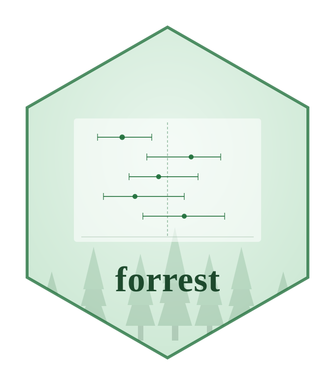

<!-- README.md is generated from README.Rmd. Do not edit it directly. -->

```{r setup, include = FALSE}
knitr::opts_chunk$set(
  collapse  = TRUE,
  comment   = "#>",
  fig.path  = "man/figures/README-",
  out.width = "100%",
  fig.width = 7,
  fig.height = 4.5,
  dpi       = 150
)
```

# forrest 

<!-- badges: start -->

[](https://CRAN.R-project.org/package=forrest)
[](https://cran.r-project.org/package=forrest)
[](https://lorenzoFabbri.r-universe.dev/forrest)
[](https://lifecycle.r-lib.org/articles/stages.html#stable)
[](https://github.com/lorenzoFabbri/forrest/actions/workflows/R-CMD-check.yaml)
[](https://app.codecov.io/gh/lorenzoFabbri/forrest?branch=main)
[](https://buymeacoffee.com/epilorenzo)

<!-- badges: end -->

`forrest` draws publication-ready forest plots from any data frame with one row per estimate and columns for the point estimate and its confidence limits: regression coefficients, subgroup estimates, studies in a meta-analysis, exposure categories. Its only dependency is [tinyplot](https://github.com/grantmcdermott/tinyplot).

A single function, `forrest()`, covers the layouts these tables need:

- bold section headers, and optionally a second level of sub-headers, generated from grouping columns, so the data never need hand-inserted blank rows;
- diamonds for pooled or overall estimates, and label-only rows for reference categories;
- colours and point shapes mapped from columns, with legends, and several estimates per row offset vertically so their intervals do not overlap;
- formatted text columns beside the plot, such as estimates with confidence intervals or p-values;
- a log axis for ratio measures, marker sizes scaled by study weight, row stripes, three themes, and arrows where an interval runs past the axis limits.

`save_forrest()` writes the plot to PDF, PNG, SVG or TIFF. Both functions accept data frames, tibbles and data.tables.

## Installation

```{r, eval = FALSE}
install.packages("forrest")

# Development version from GitHub:
# install.packages("pak")
pak::pak("lorenzoFabbri/forrest")
```

## Examples

### Several estimates per row

The minimal call names three columns: `estimate`, `lower` and `upper`. Here each exposure class has two estimates, one per period; `group` colours them and `dodge = TRUE` draws both within the exposure's row. The [introduction](https://lorenzofabbri.github.io/forrest/vignettes/intro.html) shows every feature in turn.

```{r intro, fig.height = 4, fig.width = 9}
library(forrest)

# Two estimates per exposure (e.g., two time windows)
periods <- data.frame(
  exposure = rep(c("Metals", "OPPs", "PFAS", "Phenols", "Phthalates"), each = 2),
  period   = rep(c("Pregnancy", "Childhood"), 5),
  est      = c( 0.03, -0.04, -0.03,  0.04, -0.17, -0.02,  0.10, -0.02,  0.07,  0.10),
  lo       = c(-0.25, -0.26, -0.19, -0.12, -0.40, -0.24, -0.06, -0.10, -0.15, -0.08),
  hi       = c( 0.30,  0.19,  0.13,  0.21,  0.06,  0.19,  0.26,  0.07,  0.29,  0.28)
)

forrest(
  periods,
  estimate = "est",
  lower    = "lo",
  upper    = "hi",
  label    = "exposure",
  group    = "period",
  dodge    = TRUE,
  header   = "Exposure class",
  xlab     = "Coefficient (95% CI)"
)
```

### Meta-analysis

With `log_scale = TRUE` the axis is logarithmic and the reference line moves to 1. `is_summary` draws the pooled row as a diamond, and `weight` scales each study's marker by its inverse-variance weight. The [meta-analysis vignette](https://lorenzofabbri.github.io/forrest/vignettes/meta.html) adds subgroup analyses and several exposures per study.

```{r meta, fig.height = 4.5, fig.width = 9}
ma <- data.frame(
  study  = c("Adams 2016", "Baker 2018", "Chen 2019",
             "Davis 2020", "Evans 2021", "Pooled"),
  est    = c(1.45, 0.88, 1.21, 1.07, 0.95, 1.09),
  lo     = c(1.10, 0.65, 0.92, 0.80, 0.72, 0.94),
  hi     = c(1.91, 1.19, 1.59, 1.43, 1.25, 1.26),
  weight = c(180, 95, 140, 210, 160, NA),
  is_sum = c(FALSE, FALSE, FALSE, FALSE, FALSE, TRUE)
)
ma$or_ci <- sprintf("%.2f (%.2f, %.2f)", ma$est, ma$lo, ma$hi)

forrest(
  ma,
  estimate   = "est",
  lower      = "lo",
  upper      = "hi",
  label      = "study",
  is_summary = "is_sum",
  weight     = "weight",
  log_scale  = TRUE,
  header     = "Study",
  cols       = c("OR (95% CI)" = "or_ci"),
  widths     = c(2.2, 4, 2.5),
  xlab       = "Odds ratio (95% CI)"
)
```

### Section headers

With `section`, `forrest()` inserts a bold header wherever the named column changes value, indents the rows beneath it and leaves a blank row after each group.

```{r section, fig.height = 5, fig.width = 8}
subgroups <- data.frame(
  domain   = c("Lifestyle",  "Lifestyle",  "Lifestyle",
               "Clinical",   "Clinical",
               "Socioeconomic"),
  exposure = c("Physical activity", "Diet quality", "Sleep duration",
               "Systolic BP (per 10 mmHg)", "BMI (per 5 kg/m\u00b2)",
               "Area deprivation"),
  est      = c(-0.31, -0.18, 0.09, 0.25,  0.19, 0.14),
  lo       = c(-0.51, -0.36, -0.08, 0.08, -0.02, -0.04),
  hi       = c(-0.11, -0.00,  0.26, 0.42,  0.40,  0.32)
)

forrest(
  subgroups,
  estimate = "est",
  lower    = "lo",
  upper    = "hi",
  label    = "exposure",
  section  = "domain",
  header   = "Exposure",
  xlab     = "Regression coefficient (95% CI)"
)
```

### Regression models

[`broom::tidy()`](https://broom.tidymodels.org/) turns a fitted model into a data frame that `forrest()` plots directly. `cols` adds a formatted text column and `header` labels the label column. The [regression vignette](https://lorenzofabbri.github.io/forrest/vignettes/regression.html) covers adjustment sets, multiple outcomes, exposure categories, and average treatment effects by g-computation and inverse probability weighting.

```{r regression, fig.height = 4.5, fig.width = 9}
set.seed(1)
n   <- 300
dat <- data.frame(
  sbp    = 120 + rnorm(n, sd = 15),
  age    = runif(n, 30, 70),
  female = rbinom(n, 1, 0.5),
  bmi    = rnorm(n, 26, 4),
  smoker = rbinom(n, 1, 0.2)
)
dat$sbp <- dat$sbp + 0.3 * dat$age - 4 * dat$female +
           0.5 * dat$bmi - 2 * dat$smoker + rnorm(n, sd = 6)

fit   <- lm(sbp ~ age + female + bmi + smoker, data = dat)
coefs <- broom::tidy(fit, conf.int = TRUE)
coefs <- coefs[coefs$term != "(Intercept)", ]
coefs$term <- c("Age (per 1 y)", "Female sex",
                "BMI (per 1 kg/m²)", "Current smoker")

coefs$coef_ci <- sprintf(
  "%.2f (%.2f, %.2f)",
  coefs$estimate, coefs$conf.low, coefs$conf.high
)

forrest(
  coefs,
  estimate = "estimate",
  lower    = "conf.low",
  upper    = "conf.high",
  label    = "term",
  header   = "Predictor",
  cols     = c("Coef (95% CI)" = "coef_ci"),
  widths   = c(3, 4, 2.5),
  xlab     = "Regression coefficient (95% CI)",
  stripe   = TRUE
)
```

## Compared with other packages

The table compares `forrest` with three other forest-plot packages: [forestplot](https://cran.r-project.org/package=forestplot) 3.2.0, [forestploter](https://cran.r-project.org/package=forestploter) 1.2.0 and [ggforestplot](https://github.com/NightingaleHealth/ggforestplot) 0.1.0, as checked against their documentation and source in November 2026. A ⚠️ marks partial support, explained below the table.

| Feature                                   | forrest | forestplot | forestploter | ggforestplot |
| ----------------------------------------- | :-----: | :--------: | :----------: | :----------: |
| Dependencies outside base R              |    1    |     2      |      2       |      19      |
| Not tied to meta-analysis                 |   ✅    |     ✅     |      ✅      |      ⚠️      |
| Marker size from weights                  |   ✅    |     ✅     |      ✅      |      ❌      |
| Section headers from a grouping column    |   ✅    |     ❌     |      ❌      |      ❌      |
| Two levels of section headers             |   ✅    |     ❌     |      ❌      |      ❌      |
| Summary diamonds                          |   ✅    |     ✅     |      ✅      |      ❌      |
| Text columns                              |   ✅    |     ✅     |      ✅      |      ❌      |
| Row stripes                               |   ✅    |     ✅     |      ✅      |      ✅      |
| Arrows for intervals past the axis limits |   ✅    |     ✅     |      ✅      |      ❌      |
| Colour by group, with legend              |   ✅    |     ✅     |      ✅      |      ✅      |
| Log axis                                  |   ✅    |     ✅     |      ✅      |      ✅      |
| Function to save the plot to a file       |   ✅    |     ❌     |      ⚠️      |      ❌      |
| Release or commit in the past year        |   ✅    |     ✅     |      ✅      |      ❌      |

ggforestplot takes standard errors rather than confidence limits and is built around biomarker association plots. forestploter has no save function, but `get_wh()` returns the dimensions to pass to a graphics device.

## Acknowledgements

forrest was developed with the assistance of [Claude Code](https://claude.com/product/claude-code), Anthropic's agentic coding tool.
